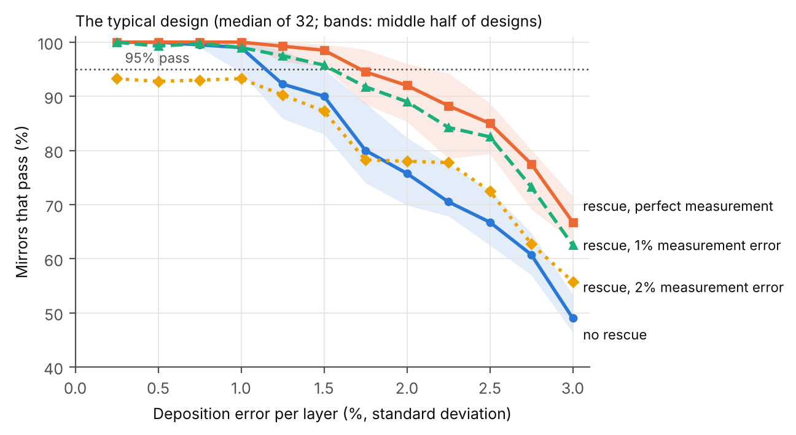
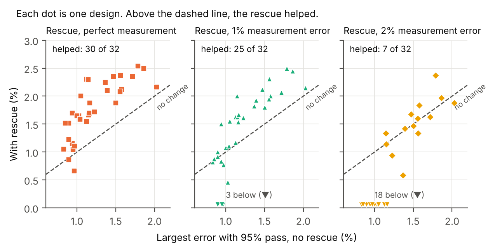

# Shadow paper: Can we fix LIGO mirror coatings while they are being made?

**What this file is.** A full version of our paper, written by Claude in
very simple words, so that we can see exactly what we did. It is a study
copy, **not** the paper we submit. Journals do not accept text written by
AI, so Tonmay writes the real paper himself and uses this only as a fact
sheet. Every number here comes from a file in this repository, and the file
is named next to it.

Version 2, written from scratch on 15 Nov 2026 around the 32-design study.
Version 1 (built on three designs) is in the git history.

---

## Summary (abstract)

LIGO's mirrors carry a coating of 40 thin layers. Every layer must have the
right thickness, but coating machines always make each layer a little too
thick or too thin. If the mistakes are too big, the mirror fails its
specification.

We asked: **can** we save such mirrors by measuring the layers already
made and then re-designing the last few layers to cancel the mistakes? We
call this the *rescue*. We tested it in computer simulations on a mirror
like the Advanced LIGO end mirror, which must let through 4 to 6 parts per
million of the infrared light (1064 nm) and 1% to 4% of the green light
(532 nm). We did not trust one design: we made 32 different designs that all
meet the specification and tested every one the same way.

When each layer has its own random error and the layers are measured
perfectly, the rescue of the top 4 layers raised the largest error that
still lets 95% of mirrors pass from 1.14% to 1.71% for the typical (median)
design. It helped 30 of the 32 designs. With 1% measurement error it still
helped 25 of 32 (typical 1.58%). With 2% measurement error it made things
worse for 25 of 32, because it "repaired" mirrors that were already fine.
When all layers are off by the *same* amount, the rescue helped a little
(typical pass rate 66% to 76% at 1% error) but no design reached 95%.
The rescue did not change thermal noise (median change −0.02%).

So: yes, the rescue can make mirrors tolerate about 1.4 times bigger random
errors, but only if layers are measured to about 1% or better. It probably
can't save mirrors when measurement is off by 2%, and it can't fix a
machine that is off in the same direction for every layer.

---

## 1. Introduction

### 1.1 LIGO and its mirrors

LIGO detects gravitational waves: tiny stretches and squeezes of space made
by events such as two black holes merging. It measures them with laser light
bouncing between mirrors 4 km apart. A passing wave changes that distance by
much less than the size of a proton.

The mirrors are heavy glass blocks covered by a coating. The coating is a
stack of thin layers of two materials:

- silica (SiO2), low refractive index (1.45), and
- titania-doped tantala (Ti:Ta2O5), high refractive index (2.06).

Light reflects a little at every boundary between the two. If every layer
has the right thickness, the small reflections add up and the mirror
reflects almost everything.

### 1.2 Two things the coating must get right

**Thermal noise.** The atoms in a warm coating jiggle, so the mirror surface
moves a tiny bit, and LIGO sees this as noise. This "coating Brownian noise"
is the largest thermal noise in LIGO's mirrors (Advanced LIGO paper, 2015).
Tantala is the main cause, so designers like to use less of it.

**The light targets.** The end mirror has two jobs at once (LIGO document
E0900068):

- At 1064 nm (the main laser), it must let through 5 ± 1 ppm, so 4 to 6 ppm.
- At 532 nm (a green laser used to control the arms), it must let through
  1% to 4%.

Hitting both needs every layer to be the right thickness.

### 1.3 The problem: layers never come out perfect

Coating machines make one layer at a time, from the glass upward. Each layer
comes out slightly off, often by about 1% or a few nanometres.

This has really happened. The Advanced LIGO paper (Section 4.3) says that
for the end mirrors "a systematic error in the layer thicknesses left the
1064 nm transmission in spec, but caused the 532 nm transmission to be
larger than desired by an order of magnitude". The green target was missed
by about ten times.

### 1.4 What others have done

- **Venugopalan et al. 2024** (Caltech, the OptimalBragg code) designed
  LIGO-type coatings and checked them with random errors of about 0.5%. The
  design is fixed before coating starts.
- **Pierro et al. 2021** searched many multi-material designs. Their
  robustness test was about absorption, not thickness.
- **Pierro et al. 2026** made three-material coatings at LMA with fixed
  designs and checked them against ±0.5 nm errors.
- In general optics (not gravitational waves), measuring the layers during
  coating and re-optimizing the layers not yet made is a known method
  (Tikhonravov and Trubetskov 2012; Wilbrandt et al. 2008 at Fraunhofer
  IOF; Melzig et al. 2024).
- **Poitras and Ma 2025** simulated re-optimizing after every layer for
  laser facet coatings.

We did not find a study that tests this for a gravitational-wave mirror,
with its two-colour target and its thermal noise. Our search was not
complete and coating labs may do it without publishing, so we say "we did
not find", not "it has never been done".

### 1.5 Our question

The main question is a yes-or-no one:

> **Can re-designing only the top few layers, after the rest of an Advanced
> LIGO-style end mirror has been made with thickness errors, let the mirror
> tolerate larger errors?**

We split it into three parts:

1. How much bigger can the thickness errors be while 95% of mirrors still
   pass?
2. How does this depend on how well the made layers can be measured?
3. Does the rescue cost anything in thermal noise?

Because the question starts with "can", a clear "no, probably not" in some
situation is also an answer, not a failure. We report those cases as
plainly as the "yes" ones.

### 1.6 Scope

- Computer simulation only. No coating was made.
- One kind of mirror: a 40-layer silica/tantala end mirror with the Advanced
  LIGO two-colour targets.
- Only thickness errors. No index errors, no absorption, no uneven layers.
- The rescue happens once, just before the last 4 layers, and is applied to
  every mirror.

### 1.7 What we expected

Written in the proposal before the main runs:

- Either the rescue clearly raises the tolerable error (for example from
  about 1% to 2-3%), even with realistic measurement error, at almost no
  noise cost;
- or the gain disappears quickly as measurement error grows, and the
  useful result is how good the measurement must be.

On Day 3 we added a hope: maybe the rescue could make a quiet but fragile
design as reliable as a noisier, sturdy one.

---

## 2. Methods

Everything here can be re-run from the repository. All code is Python 3.
Install with `pip3 install -r requirements.txt` (OptimalBragg 1.0.2, numpy,
scipy, matplotlib, pytest). Tests: `python3 -m pytest -q tests` (6 tests,
all pass).

### 2.1 The mirror

- 40 layers in total: 20 tantala (H) and 20 silica (L), alternating. The top
  layer, next to air, is a thicker silica layer, a "half-wave cap"
  (366.9 nm). Below it the pattern is H, L, H, ..., H (39 layers), on a
  silica substrate.
- Numbering follows OptimalBragg: layer 0 is the top (the cap, made last);
  layer 39 touches the glass (made first).
- Starting stack: the plain quarter-wave stack at 1064 nm (129.1 nm per
  tantala layer, 183.4 nm per silica layer), made with
  `qw_stack(1064 nm, substrate, air, films, "HL"*19 + "H", hwcap="L")`.
  Code: `rescue.py`, `build_stack()`.
- Substrate temperature setting: 295 K.

Material values (from OptimalBragg, which cites arXiv:0912.0107):

| | SiO2 | Ti:Ta2O5 |
| --- | --- | --- |
| Refractive index | 1.45 | 2.06 |
| Young's modulus | 60 GPa | 140 GPa |
| Poisson ratio | 0.17 | 0.23 |
| Mechanical loss angle | 5 × 10⁻⁵ | 2 × 10⁻⁴ |

The same index is used at both wavelengths (OptimalBragg stores one value).

### 2.2 Computing the light

Transmission at 1064 nm and 532 nm, light hitting straight on, by the
transfer-matrix method (`OptimalBragg.layers.trans`): each layer is a 2×2
matrix, and multiplying them gives the whole stack. Code:
`rescue.transmissions(Ls)`.

Check: one quarter-wave tantala layer on glass gives the textbook
reflectance ((nₛ − n₁²)/(nₛ + n₁²))² to better than 10⁻⁶
(`tests/test_rescue.py`).

### 2.3 Computing thermal noise

**Full formula** (for reported noise values): Hong et al. 2013, as written in
OptimalBragg (`OptimalBragg.noise.coating_brownian`). Beam radius 6.2 cm
(Advanced LIGO end mirror, Advanced LIGO paper Tables 1 and 3). Reported as
amplitude spectral density at 100 Hz, in m/√Hz.

**Quick stand-in** (inside optimizers and Monte Carlo runs): from E0900068,

> proxy = (total silica thickness) + γ_H × (total tantala thickness),
> γ_H = 3.888 (`OptimalBragg.noise.brownian_proxy`).

Code: `rescue.noise_proxy(Ls)`. Section 3.7 checks that the stand-in agrees
with the full formula.

If tantala's loss angle is 3.6 × 10⁻⁴ instead (as in Venugopalan et al.),
every noise value rises by 26-29%, but no pass rate changes, because passing
depends only on light.

### 2.4 The pass test

A mirror **passes** if 4 ppm ≤ T(1064) ≤ 6 ppm **and** 1% ≤ T(532) ≤ 4%
(E0900068). Noise is not part of the test. Code: `rescue.passes(Ls)`.

### 2.5 The 32 designs

A design is a list of 40 layer thicknesses. Many different designs meet the
targets, and they differ in how well they survive errors. So we tested a
whole set of designs, not one.

**How a design is made.** Differential evolution (SciPy) minimizes

> cost = 5 × [max(0, log₁₀(T₁₀₆₄ / 5 ppm))]² + 3 × [log₁₀(T₅₃₂ / 0.025)]²
> + 0.5 × (proxy / proxy of the plain quarter-wave stack)

In words: get 1064 nm down to 5 ppm (lower is not punished), get 532 nm to
2.5% (the middle of the 1-4% window, so errors have room both ways), and
keep the noise stand-in small. The cap (layer 0) is fixed. The other 39
layers may be 0.3× to 1.7× their quarter-wave thickness. Settings:
population 8, at most 400 generations, tol 10⁻¹⁰, Sobol starting points,
final polish. Only the random seed changes between designs.

Command: `python3 scripts/make_designs.py SEED designs/population/seedSEED.npy`

**The set.**

- 30 designs from seeds 1 to 30 (`designs/population/`). The script and the
  seed list were committed before any results. Seed 21 fails the 1064 nm
  target even with no errors (6.35 ppm), so it is left out. That gives 29.
- 3 designs made on Day 3 with the same kind of optimizer, before the script
  existed (`designs/lownoise_seed5_t2.5.npy`, `designs/seed2_t2.5.npy`,
  `designs/robust_seed9_t2.5.npy`). The Day 3 code was not saved, and the
  script does not re-make them exactly. They are treated as
  ordinary members of the set.

Total: **32 designs**, all meeting the spec with no errors.

Across the 32 designs, full noise at 100 Hz goes from 6.18 to 6.72 × 10⁻²¹
m/√Hz (about 9% apart). For comparison, the plain quarter-wave stack has
6.53 × 10⁻²¹ m/√Hz but fails the green target (96.6% at 532 nm).
Per-design values: `results/population/summary.txt`.

### 2.6 How layers come out wrong (deposition error)

True thickness of layer *i*:

> dᵢ = dᵢ⁽⁰⁾ × (1 + εᵢ)

dᵢ⁽⁰⁾ is the planned thickness; εᵢ is random, from a bell curve with mean 0
and standard deviation σ (the "deposition error").

- **Independent errors (main model):** each layer gets its own εᵢ.
- **Shared error:** one ε for all 40 layers, including the re-made ones. Like
  a machine that is always off in the same direction. (OptimalBragg's own
  Monte Carlo uses this kind.)

### 2.7 How layers are measured (measurement error)

The machine does not see true thicknesses. It sees

> measured = true × (1 + μᵢ)

with μᵢ from a bell curve with mean 0 and standard deviation σ_meas, new for
every layer. σ_meas = 0, 1%, 2%. Code: `rescue.measure()`.

We sweep it because no source gives one agreed value. Sources for its size:
typical deposition errors about 1 nm + 1% (Tikhonravov and Trubetskov 2012);
run-to-run spread 0.9-1.5%, and optical vs quartz-crystal readings about
2.6% apart (Wilbrandt et al. 2008); fitted thicknesses off by up to about
4 nm per layer (Melzig et al. 2024).

### 2.8 One simulated mirror, step by step

Code: `rescue.trial()`. Inputs: design, rescue size *k*, σ, σ_meas.

1. Draw εᵢ for **every** layer, 0 to 39 (shared model: one ε copied to all).
   Drawing them all first means the same mirror can be compared with and
   without rescue.
2. Make layers *k*+1 to 39 with their errors. Layers 0 to *k* are not made
   yet.
3. Measure layers *k*+1 to 39, with measurement error.
4. **Rescue.** Using only the *measured* thicknesses, find new thicknesses
   for layers 1 to *k* (the cap, layer 0, never changes) that minimize

   > cost = 5 × [log₁₀(T₁₀₆₄ / 5 ppm)]² + 3 × [log₁₀(T₅₃₂ / 2.5%)]²
   > + 0.05 × (proxy / proxy of the design)

   Each new thickness may be 0.5× to 1.5× its planned value. Optimizer:
   L-BFGS-B (SciPy `minimize`), started three times (planned thicknesses,
   0.9×, 1.1×); the best is kept.
5. Make layers 0 to *k* **with the errors drawn in step 1**. The rescue does
   not get perfect layers.
6. Judge the finished mirror on its **true** thicknesses with the pass test.
   Record the change in the noise stand-in compared with the design.

*k* = 0 means no rescue. The population runs use *k* = 4.

Notes:
- The rescue runs on **every** mirror, even one that would already pass.
  This matters for the measurement-error results (Section 4).
- The weights 5, 3 and 0.05 are our choices. On Day 2, noise weights 0,
  0.05 and 0.5 gave the same pass rates.
- Why *k* = 4: on one design (`robust_seed9_t2.5`, 400 mirrors per point)
  *k* = 2, 4 and 6 gave tolerable errors of 2.51%, 2.65% and 2.47%, with
  overlapping uncertainty ranges (`results/day7/bootstrap_sturdy.txt`). So
  2 to 6 layers work about the same, and we used 4. We did not test other
  *k* on all 32 designs.

### 2.9 The Monte Carlo runs

For each setting we simulate many mirrors and count how many pass.
Uncertainty on a pass rate: √(p(1 − p)/N).

**Random numbers.** Mirror *i* at deposition error σ always gets the same
errors, from `numpy.random.default_rng([0, round(σ × 10⁵), i])`. Its
measurement errors come from a separate generator,
`default_rng([0, round(σ × 10⁵), round(σ_meas × 10⁵) + 1, i])`. So every
design, every *k* and every measurement level sees the very same mirrors,
and differences come from the settings, not from luck.

**Runs on all 33 designs** (seed 21 is run but not counted):

| Run | Errors | σ | σ_meas | *k* | Mirrors per point | Script | Output |
| --- | --- | --- | --- | --- | --- | --- | --- |
| A. Fine scan | independent | 0.25% to 3%, steps of 0.25% | 0, 1, 2% | 0, 4 | 200 | `scripts/population_fine.sh` | `results/population_fine/` |
| B. Single point | independent | 2% | 0, 1, 2% | 0, 4 | 200 | `scripts/population_study.sh` | `results/population/` |
| C. Shared error | shared | 1%, 2% | 0, 1, 2% | 0, 4 | 200 | `scripts/population_shared.sh` | `results/population_shared/` |

(Run A has no seed 21 file; it was already excluded.)

Each run calls, per design, for example:

```
python3 scripts/run_sweep.py --design designs/population/seed1.npy \
  --trials 200 --k 0 4 --dep 0.0025 0.005 ... 0.03 --meas 0 0.01 0.02 \
  --t2 0.025 --jobs 2 --out results/population_fine/sweep_seed1.csv
```

(Run C adds `--model common`.)

### 2.10 The main number: tolerable error

For each design and each curve (pass rate against σ), the **tolerable
error** is the σ where the pass rate drops to 95%. We take the first σ step
where the pass rate is below 95% and draw a straight line to the step before.
If the pass rate is already below 95% at 0.25%, we write "below" and count it
as 0. If it never drops below 95% up to 3%, we would count it as 3% (this
never happened).

**Uncertainty for one design (bootstrap).** Each pass count is redrawn from a
binomial distribution 2000 times (random seed 0) and the tolerable error is
recomputed. The middle 95% is the range. "Clearly higher" means the two
ranges do not overlap. The bootstrap treats the two curves as if they had
different mirrors. They share their mirrors, which makes the real
difference *less* uncertain than this, so "clearly" is on the safe side.

**Across designs.** We report the median and the middle half (25th to 75th
percentile) of the 32 values, and count how many designs go up or down.

**Statistical tests.** Code: `scripts/stats_checks.py` →
`results/stats/stats_checks.txt`.

- *Sign test.* If the rescue did nothing, each design would be equally
  likely to go up or down. The sign test (exact binomial, p = ½, ties left
  out) gives the chance of seeing a count like ours by luck.
- *Paired test per design (exact McNemar).* For one error size we re-ran
  every mirror and saved pass/fail for each one (`scripts/paired_outcomes.py`,
  independent 2% and shared 1%; the re-run gave exactly the saved pass
  rates). For each design we count mirrors **saved** by the rescue (fail →
  pass) and mirrors **broken** by it (pass → fail), and test whether saved
  and broken differ (two-sided binomial on the two counts). This uses the
  fact that both arms see the same mirrors. Because we test 32 designs, we
  also give the count after Holm correction.
- *Rank correlation (Spearman).* For "do sturdier designs behave
  differently?". We report 16 correlations in total, so every p-value is
  also given after Holm correction over all 16. Holm correction makes each
  p-value stricter so that, across many tests, the chance of even one false
  "significant" stays at 5%.

Code: `scripts/population_tolerable.py` → `results/population_fine/summary.txt`.
Single-point and shared runs: `scripts/population_summary.py [dir] [σ]` →
`results/population/summary.txt`, `results/population_shared/summary_dep0.01.txt`,
`summary_dep0.02.txt`. Quiet vs noisy groups:
`scripts/population_quiet_vs_noisy.py` → `results/population_fine/quiet_vs_noisy.txt`.

### 2.11 Extra checks (on one or two designs)

These were run earlier on the Day 3 designs. They test the method, not the
population.

1. **Hand cases** (`scripts/day2_hand_case.py`): one layer 5% too thick; a
   random 2% failing mirror; the same with 1% measurement error. The rescue
   brought each back into spec.
2. **Fast vs slow optimizer** (`scripts/day6_de_check.py`): the same mirrors
   rescued with L-BFGS-B and with differential evolution (max 300
   generations, population 15, tol 10⁻¹⁰, polish, seed 0). *k* = 4, 100
   mirrors per row, designs `lownoise_seed5_t2.5` and `robust_seed9_t2.5`,
   both error models, σ = 2% and 3%, σ_meas = 0 and 1%: 1600 mirrors.
3. **Full noise vs stand-in** (`scripts/day6_full_noise.py`): 40 mirrors per
   case, σ = 2% independent, *k* = 0 and 4, σ_meas = 0 and 1%, same two
   designs.
4. **Why mirrors fail** (`scripts/day7_failures.py`): 200 mirrors per case;
   for each failed mirror, which target it missed and in which direction.
5. **Size of the real Advanced LIGO problem** (`scripts/day6_aligo_size.py`):
   no randomness; all thicknesses (or only tantala, or only silica) scaled by
   (1 + e), e from −10% to +10% in 0.25% steps; find the smallest e that makes
   T(532) ten times the design value.
6. **Repeat of one fine scan with more mirrors**: `robust_seed9_t2.5` was
   also scanned with 400 mirrors per point (σ = 1-3%,
   `results/day5/fine_sturdy.csv`).

### 2.12 Figures

`python3 scripts/make_population_figures.py` makes Figures 1-4 from saved
results only. Output: `paper/figures/`. Every plotted number is also written
to `paper/figures/figure_values.txt`.

---

## 3. Results

### 3.1 The typical design (Figure 1)



*Figure 1. Median pass rate of the 32 designs at each error size. Shaded
bands: middle half of the designs (no rescue, and rescue with perfect
measurement). Independent errors, 200 mirrors per point, top 4 layers
re-designed.*

Without rescue, the typical design passes 99% of mirrors at 1% error, 76% at
2% and 49% at 3%. With rescue and perfect measurement: 100%, 92% and 67%.

With 2% measurement error, the typical design passes only about 93% of
mirrors **even at 0.25% error**, where almost every mirror would pass without
rescue. The rescue is breaking good mirrors.

Source: `paper/figures/figure_values.txt`.

### 3.2 Question 1: how much bigger can the errors be? (Figure 2, left)



*Figure 2. Each dot is one design. x: largest error with 95% pass, no rescue.
y: the same with rescue. Above the dashed line the rescue helped. ▼: below
95% already at 0.25% error.*

| | Median tolerable error | Middle half of designs |
| --- | --- | --- |
| No rescue | 1.14% | 0.96-1.48% |
| Rescue, perfect measurement | 1.71% | 1.52-2.19% |

- The rescue raised the tolerable error in **30 of 32** designs; in 27 the
  uncertainty ranges do not overlap.
- Typical gain: 1.43 times (range across designs 0.68 to 2.04).
- Two designs got worse: `seed1` (0.96% → 0.66%, clearly) and
  `lownoise_seed5_t2.5` (0.90% → 0.86%, ranges overlap).
- Sign test: 30 up, 2 down, p = 2 × 10⁻⁷. This is not luck.
- Sturdier designs did not clearly gain more than fragile ones (Spearman
  ρ = +0.30, p = 0.09; after Holm correction p = 0.6: no evidence).

The same picture at one error size (2%, run B): typical pass rate 76% → 92%;
the rescue raised it for all 32 designs (sign test p = 5 × 10⁻¹⁰). Without
rescue 1 design reached 95%; with rescue 13 did.

Mirror by mirror (paired test, same point): over all 32 designs the rescue
saved 848 mirrors and broke 38. It was significantly better for 30 designs
(28 after Holm correction) and significantly worse for none.

Repeat check: `robust_seed9_t2.5` gave 1.79% → 2.54% here (200 mirrors) and
1.69% → 2.65% in the separate 400-mirror scan. The ranges overlap. This
design is the 3rd sturdiest of the 32, so its gain is near the top, not
typical.

Source: `results/population_fine/summary.txt`, `results/population/summary.txt`.

### 3.3 Question 2: how much does measurement matter? (Figure 2, middle and right)

| Measurement error | Median tolerable error | Rescue helped | Rescue hurt | Sign test |
| --- | --- | --- | --- | --- |
| 0% | 1.71% | 30 of 32 (27 clearly) | 2 (1 clearly) | p = 2 × 10⁻⁷ |
| 1% | 1.58% | 25 of 32 (14 clearly) | 7 (3 clearly) | p = 0.002 |
| 2% | below 0.25% | 7 of 32 (1 clearly) | 25 (18 clearly) | p = 0.002 (hurt) |

(No rescue: 1.14%.)

Mirror by mirror at 2% deposition error (paired test):

| Measurement error | Mirrors saved | Mirrors broken | Designs significantly better / worse (after Holm) |
| --- | --- | --- | --- |
| 0% | 848 | 38 | 28 / 0 |
| 1% | 759 | 190 | 25 / 1 |
| 2% | 547 | 609 | 1 / 2 |

- At **1%** measurement error the rescue still helps most designs, but less
  surely.
- At **2%** it hurts most designs. For 18 of 32, fewer than 95% of mirrors
  pass even at 0.25% error. At 2% deposition error it breaks more mirrors
  than it saves (609 vs 547).
- **Sturdier designs lose less** when measurement gets worse. Tolerable
  error without rescue vs loss from 0% to 2% measurement error: ρ = −0.52,
  p = 0.002 (Holm p = 0.02). In run B (2% error, pass rates) the same link
  is stronger: ρ = −0.87 (Holm p = 10⁻⁹). At 2% measurement error, every
  design that still gained was among the sturdier half.

Source: `results/population_fine/summary.txt`, `results/population/summary.txt`,
`results/stats/stats_checks.txt`.

### 3.4 Can the rescue make quiet designs as good as noisy ones?

Quieter designs are more fragile. Noise stand-in vs tolerable error without
rescue: ρ = +0.67, p = 3 × 10⁻⁵ (Holm p = 0.0004). We compared the 10 quietest and the 10
noisiest designs:

| Group | Noise at 100 Hz (median) | No rescue | Rescue, 0% | Rescue, 1% | Rescue, 2% |
| --- | --- | --- | --- | --- | --- |
| 10 quietest | 6.19 × 10⁻²¹ | 0.92% | 1.52% | 0.90% | below |
| 10 noisiest | 6.68 × 10⁻²¹ | 1.40% | 2.21% | 1.98% | 1.33% |

(Median tolerable error of each group.)

With perfect measurement, rescued quiet designs (1.52%) tolerate about as
much as noisy designs without rescue (1.40%), with 7% less noise. With 1%
measurement error that gain is gone: 0.90%, no better than no rescue. So
the rescue can make quiet designs as sturdy as noisy ones only if
measurement is close to perfect. With realistic measurement it probably
can't.

Source: `results/population_fine/quiet_vs_noisy.txt`.

### 3.5 Shared errors: the rescue helps a little (Figure 3)


*Figure 3. Pass rate of each design without and with rescue (perfect
measurement). Grey lines join the same design; black line: median.*

| | Independent, 2% | Shared, 1% | Shared, 2% |
| --- | --- | --- | --- |
| Median pass, no rescue | 76% | 66% | 40% |
| Median pass, rescue (meas 0 / 1 / 2%) | 92 / 89 / 78% | 76 / 74 / 69% | 48 / 46 / 42% |
| Rescue raised pass rate (perfect meas.) | 32 of 32 | 31 of 32 | 29 of 32 |
| Best design after rescue | 99.5% | 91.5% | 56% |
| Designs reaching 95% after rescue | 13 of 32 | **0 of 32** | **0 of 32** |

A shared error is much harder: at 1% shared error the typical design already
fails a third of its mirrors. The rescue adds about 10 points, but no design
reaches 95%, even at 1%.

The small gain is real, not luck. Sign test at 1%: 31 up, 1 down,
p = 2 × 10⁻⁸. Mirror by mirror at 1%: 700 saved, 29 broken; significantly
better for 27 designs after Holm correction, worse for none. At 2% shared
error, sturdier designs gained *less* (ρ = −0.66, Holm p = 0.0005).

Why: with independent errors, the ups and downs of 40 layers partly cancel.
A shared error does not cancel; it shifts the whole mirror, and 4 layers
cannot undo a change in all 40.

Source: `results/population_shared/summary_dep0.01.txt`, `summary_dep0.02.txt`.

### 3.6 Why mirrors fail (Figure 4, one design)


*Figure 4. Design `robust_seed9_t2.5`, 200 mirrors per bar, rescue with
perfect measurement. Failures sorted by which target was missed.*

This is a worked example on one design, not a population result.

- Without rescue, most failures are "too much green light" (532 nm above 4%).
- The rescue removes most of these. What is left mostly fails at 1064 nm
  (above 6 ppm). Example, 3% independent error: without rescue 40 fail at
  532 nm only, 17 at 1064 nm only, 18 at both; with rescue 5 and 16 and 0.
- With a shared error the biggest group is "both too high", which the rescue
  cannot fix.
- Failures are almost always "too much light", almost never "too little".

So the narrow 1064 nm window (4-6 ppm) is what limits the rescue.

Source: `results/day7/failures.txt`.

### 3.7 Noise cost (question 3)

Across all 32 designs (run A), the rescue changed the noise stand-in by a
median of −0.02% (range −0.43% to +0.19%, averaged over all error sizes).

Full-formula check on two designs (Section 2.11, check 3): average change
−0.13% to −0.20%; single mirrors −0.85% to +0.55%. The stand-in gave the
same sign and size (−0.23% to −0.34%).

So the rescue does not make the mirror noisier.

Source: `results/population_fine/summary.txt`, `results/day6/full_noise.txt`.

### 3.8 Checks on the method

- **Fast vs slow optimizer.** Of 1600 mirrors, the slow optimizer passed 22
  that the fast one failed, and the fast one passed 5 that the slow one
  failed. On `robust_seed9_t2.5`: 4 disagreements in 800. On
  `lownoise_seed5_t2.5` with shared error the slow one rescued up to 8 more
  in 100. So our numbers may be slightly pessimistic for fragile designs
  under shared error; this does not change any conclusion
  (`results/day6/de_check.txt`).
- **The real Advanced LIGO problem.** Scaling all layers by −2.25%
  (`robust_seed9_t2.5`) or −1.00% (`lownoise_seed5_t2.5`) raises T(532)
  ten times. So a 1-3% systematic error is enough to cause the kind of
  problem seen in Advanced LIGO. But in our model 1064 nm then usually
  leaves its window too, while in the real mirrors it stayed in spec; ours
  stays in spec mainly when only one material is off (silica only: +6.00%
  and −1.50%, T(1064) 5.21 and 5.85 ppm). The real design was different and
  the size of its error is not published, so we can only say our model
  behaves in the same way (`results/day6/aligo_size.txt`).

---

## 4. Discussion

**The main question: can the rescue let the mirror tolerate larger errors?**
Yes, under two conditions: the errors are independent from layer to layer,
and the layers are measured to about 1% or better. Then the typical design
goes from 1.14% to 1.71% (perfect measurement) or 1.58% (1%). It probably
can't when measurement is off by 2%, and it can't bring shared errors to
95% for any of our 32 designs.

**Question 1.** About 1.4 times bigger errors for the typical design, and the
gain shows up in 30 of 32 designs. It is not one lucky design.

**Question 2.** Measurement is the deciding factor. The rescue trusts the
measurement completely: it changes the top layers to cancel what it sees. If
what it sees is mostly measurement noise, it adds error instead of removing
it. At 2% measurement error, this happens even to mirrors that had almost no
deposition error (Figure 1). A coating maker who wants to use the rescue
should first check that their measurement is good to about 1%. Sturdier
designs put up with bad measurement better, so the design choice matters too.

**What the 2% result does and does not say.** Our rescue runs on every
mirror. A more careful rule, for example "only re-design if the measured
mirror would fail", might avoid breaking good mirrors. We did not test this,
so our 2% result is about rescuing every mirror, not about every possible
rescue.

**Question 3.** No noise cost. The rescue moves a few nanometres in 4 layers
out of 40.

**Quiet vs sturdy.** The Day 3 hope was that the rescue could let a quiet,
fragile design match a sturdy one. With perfect measurement it roughly does
(Section 3.4). With 1% measurement error it does not. So in practice the
choice between "quieter" and "sturdier" design is not removed by the rescue.

**Compared with what we expected.** Both expected outcomes happened, at
different measurement levels: a clear gain at 0-1%, and a gain that
disappears (and turns into a loss) at 2%.

**What this means in practice.** The rescue is cheap: one extra calculation
before the last few layers, no new machine. It is useful against random
layer-to-layer errors, if measurement is good. It is not a fix for a machine
that is off in the same direction every time; that needs calibration. A
smarter rescue might estimate a shared error from the measured layers and
correct for it; we did not test this.

**The Advanced LIGO connection.** The real end mirrors had a systematic
thickness error, which is our shared-error case. Our results suggest a
top-layer rescue like ours would only partly help with such an error.

---

## 5. Limitations

- Simulation only. No coating was made or measured.
- Only thickness errors. Real coatings also have index errors, absorption
  and uneven layers.
- Measurement error is assumed (0, 1, 2%), not taken from a real machine.
- Errors are either fully independent or fully shared. Real machines have a
  mix.
- The rescue runs on every mirror, once, before the last 4 layers. Other
  rules (rescue only when needed, rescue after every layer, other *k*) were
  not tested on the population.
- We did not check whether the re-designed layers are practical to make.
  The rescue is kept within 0.5-1.5x of the planned thickness, and the
  re-made layers get deposition errors like all others, but we did not
  measure how far the new layers move, how often they hit those limits, or
  how thin they get. Real machine limits (rate control, monitoring,
  changing the recipe during a run) are not modelled.
- One kind of mirror, two materials. Future detectors use other materials
  and targets.
- 32 designs, all from one optimizer with one cost. A different design
  method could give designs that behave differently.
- The uncertainty range of a single tolerable error ignores that the
  curves share mirrors (on the safe side). The fully paired test was done at
  one error size only (2% independent, 1% shared), because it needed a
  re-run.
- 200 mirrors per point. A single tolerable error has an uncertainty of
  about ±0.1-0.3% (Section 2.10); the medians over 32 designs are steadier.
- The rescue weights (5, 3, 0.05) are our choices.
- The same refractive index is used at 532 nm and 1064 nm.
- Our literature search was not complete.

---

## 6. Conclusion

Re-designing the top 4 layers of an Advanced LIGO-style end mirror, after
measuring the layers already made, can let the mirror tolerate about 1.4
times bigger random thickness errors (typical design: 1.14% → 1.71%), at no
noise cost. We saw this in 30 of 32 designs. It needs good measurement: at
1% measurement error most of the gain remains, but at 2% the rescue (applied
to every mirror) does more harm than good. It cannot bring a shared,
same-direction error, the kind the real Advanced LIGO end mirrors had, up to
a 95% pass rate.

---

## Appendix: Where everything is

| What | Where |
| --- | --- |
| Core model (stack, light, noise stand-in, errors, rescue, one trial) | `rescue.py` |
| Tests | `tests/test_rescue.py` |
| Design maker | `scripts/make_designs.py` |
| Designs | `designs/population/` (30), `designs/` (3 Day 3) |
| Monte Carlo sweeps | `scripts/run_sweep.py` |
| Population runs | `scripts/population_fine.sh`, `population_study.sh`, `population_shared.sh` |
| Population analysis | `scripts/population_tolerable.py`, `population_summary.py`, `population_quiet_vs_noisy.py` |
| Statistical tests | `scripts/paired_outcomes.py`, `scripts/stats_checks.py` → `results/stats/` |
| Results | `results/population_fine/`, `results/population/`, `results/population_shared/`, checks in `results/day5` to `day7` |
| Figures | `paper/figures/`, made by `scripts/make_population_figures.py` |
| Day-by-day notes | `notes/` |
| References | `paper/references.bib` |

## References

- Advanced LIGO (LIGO Scientific Collaboration), Class. Quantum Grav. 32,
  074001 (2015), arXiv:1411.4547.
- LIGO-E0900068-v5, Advanced LIGO End Test Mass Coating Specification.
- Venugopalan, Salces-Cárcoba, Arai, Adhikari, Optics Express 32(7), 11751
  (2024), arXiv:2110.13437. OptimalBragg code (PyPI, version 1.0.2).
- Hong, Yang, Gustafson, Adhikari, Chen, Phys. Rev. D 87, 082001 (2013).
- Harry et al., Class. Quantum Grav. 19, 897 (2002).
- Pierro et al., Phys. Rev. Research (2021), arXiv:2012.02146.
- Pierro et al., arXiv:2601.17886 (2026).
- Poitras and Ma, Sci. Rep. (2025).
- Tikhonravov and Trubetskov, Appl. Opt. 51(30), 7319 (2012).
- Wilbrandt, Stenzel, Kaiser, Proc. SPIE 7101 (2008).
- Melzig et al., Surf. Coat. Technol. 476, 130197 (2024).
- Material values: arXiv:0912.0107 (title and authors still to confirm).
