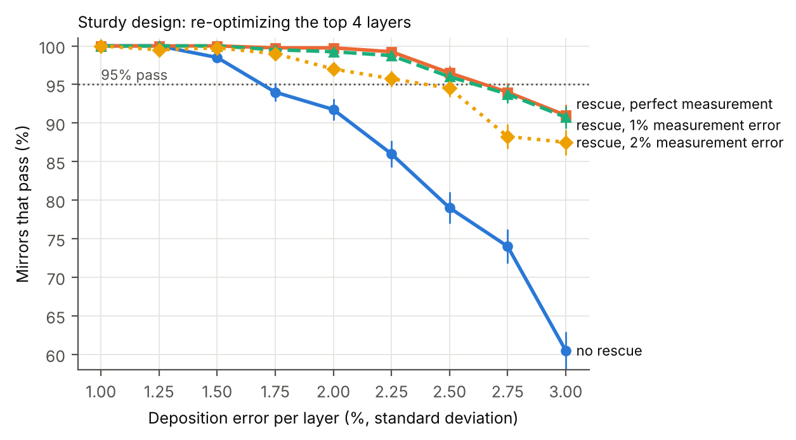
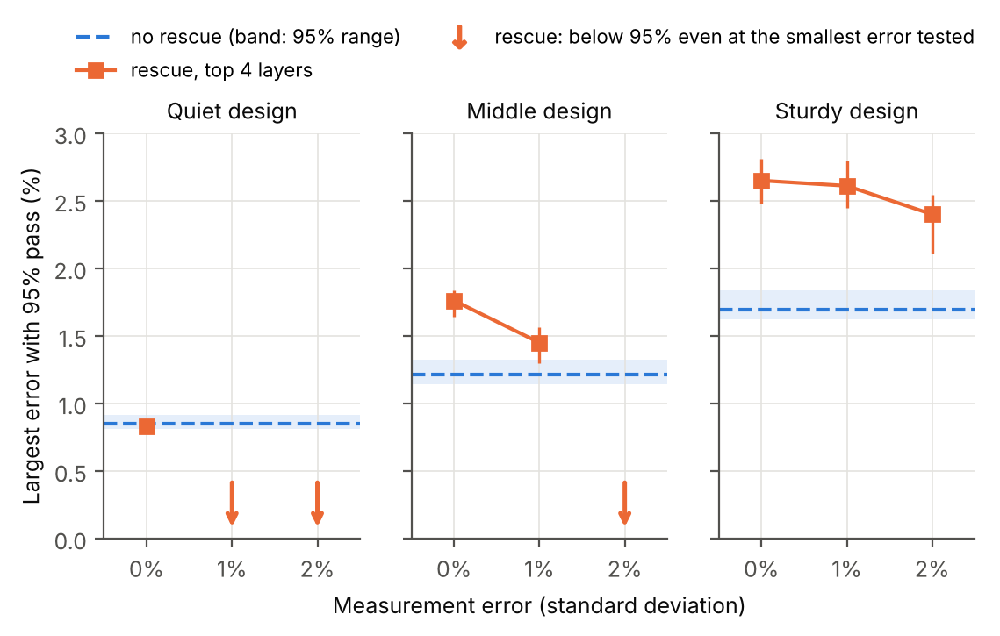
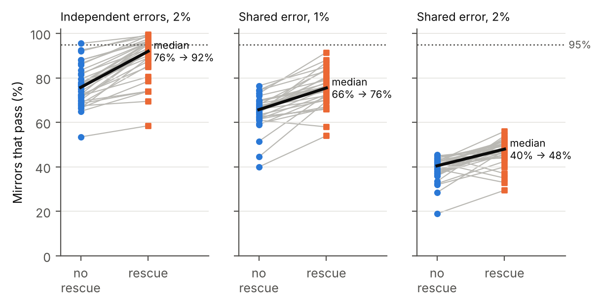
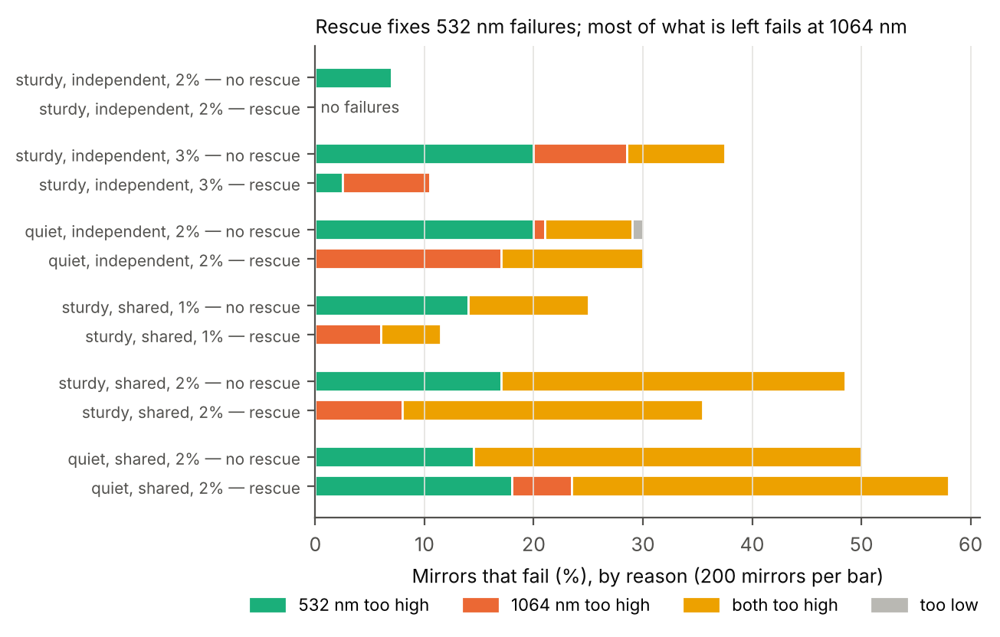

# Shadow paper: Fixing LIGO mirror coatings while they are being made

**What this file is.** A full version of our paper, written by Claude in very
simple words, so that we can see exactly what we did. It is a study copy.
It is **not** the paper we submit. Journals do not accept text written by
AI, so Tonmay writes the real paper himself, using this only as a fact sheet.
Every number here comes from a file in this repository; the file is named
next to it.

Status: all computation finished (14 Nov 2026).

---

## Summary (abstract)

LIGO's mirrors are covered by a coating of 40 thin layers of glass-like
material. Each layer must have the right thickness. In real coating
machines, every layer comes out a little too thick or too thin. A mirror
whose layers are too far off fails its specification and is wasted.

We tested a simple idea in computer simulations: after most layers are
made, measure them, and then re-design the last few layers so that they
cancel the mistakes below. We call this the *rescue*. We used a mirror like
the Advanced LIGO end mirror, which must reflect two colours of laser light
in a precise way: it must let through 4 to 6 parts per million (ppm) of the
infrared light (1064 nm) and 1% to 4% of the green light (532 nm).

For a robust ("sturdy") mirror design, re-designing the top 4 layers raised
the largest thickness error that still lets 95% of mirrors pass from about
1.7% to about 2.6%. This held even when the measurement of the layers was
off by 1% to 2%. For a second design the gain was similar with perfect
measurement, but it vanished when measurement was off by 2%. For a fragile,
lower-noise design the rescue gave no gain and often made things worse. When
all layers are off by the *same* amount (a "shared" error, which really
happened to the Advanced LIGO end mirrors), the rescue helped only a little.
The rescue did not change the mirror's thermal noise (change about -0.2%).

In short: the rescue lets a sturdy design tolerate bigger random mistakes,
but only if the layers can be measured well. It cannot save a fragile
design, and it cannot fix a machine that is always off in the same
direction.

---

## 1. Introduction

### 1.1 LIGO and its mirrors

LIGO detects gravitational waves. These are tiny stretches and squeezes of
space, made by events like two black holes merging. LIGO measures them with
laser light that bounces between mirrors 4 km apart. A gravitational wave
changes this distance by much less than the size of a proton.

The mirrors are heavy glass blocks covered by a coating. The coating is a
stack of thin layers of two materials:

- silica (SiO2), which has a low refractive index (1.45), and
- titania-doped tantala (Ti:Ta2O5), which has a high refractive index (2.06).

Light reflects a little at every boundary between the two materials. If
every layer has the right thickness, all these small reflections add up and
the mirror reflects almost all the light.

### 1.2 Why the coating matters so much

The coating causes two kinds of problems.

**Thermal noise.** The atoms in a warm coating jiggle. This makes the mirror
surface move a tiny bit, and LIGO sees that as noise. This "coating
Brownian noise" is the biggest of the thermal noises in LIGO's mirrors
(Advanced LIGO paper, 2015). The tantala layers are the main source: they
are "lossier" (they turn more vibration energy into heat) than silica. So
designers like to use less tantala.

**Getting the light right.** The end mirror has two jobs at once
(LIGO document E0900068):

- At 1064 nm (the main infrared laser), it must let through only
  5 ± 1 ppm of the light, so between 4 and 6 ppm.
- At 532 nm (a green laser used to lock and control the arms), it must let
  through between 1% and 4%.

Hitting both targets needs every layer thickness to be right.

### 1.3 The problem: layers never come out perfect

Coating machines deposit one layer at a time, from the glass up. Each layer
comes out slightly thicker or thinner than planned, often by about 1% or a
few nanometres. Small mistakes add up.

This really happened. The Advanced LIGO paper (Section 4.3) says that for
the end mirrors "a systematic error in the layer thicknesses left the
1064 nm transmission in spec, but caused the 532 nm transmission to be
larger than desired by an order of magnitude". So the green-light target
was missed by about 10 times, and that made the detector harder to control.

### 1.4 What others have done

- **Venugopalan et al. 2024** (Caltech, the OptimalBragg code) designed
  LIGO-type coatings with a global optimizer and then checked them with
  random errors of about 0.5%. Their design is fixed before the coating is
  made.
- **Pierro et al. 2021** searched many multi-material quarter-wave designs.
  Their robustness test was about absorption, not thickness.
- **Pierro et al. 2026** made ternary (three-material) coatings at LMA with
  fixed designs and checked them with independent ±0.5 nm errors.
- In general optics (not gravitational waves), there is a known method:
  measure the layers while coating and re-optimize the layers not yet
  made (Tikhonravov and Trubetskov; Fraunhofer IOF, Wilbrandt et al. 2008;
  Melzig et al. 2024).
- **Poitras and Ma 2025** simulated re-optimizing after every layer for
  laser facet coatings.

As far as our search found, nobody has tested this kind of correction for
a gravitational-wave mirror, with its two-colour target and its thermal
noise. Our search was not complete, so we say "we did not find", not "it
has never been done". Coating labs may also do this privately without
publishing it.

### 1.5 Our question

For an end mirror like Advanced LIGO's, if we re-design only the top *k*
layers after the rest have been made with random errors:

1. How much bigger can the thickness errors be while 95% of mirrors still
   pass?
2. How does this depend on how well the made layers can be measured?
3. Does the rescue cost anything in thermal noise?

### 1.6 Scope (what we did and did not do)

- Everything is a computer simulation. No coating was made.
- One type of mirror: a 40-layer silica/tantala end mirror with the
  Advanced LIGO two-colour targets.
- Only thickness errors. No errors in refractive index, no absorption, no
  uneven layers.
- The rescue happens once, before the last *k* layers, not after every
  layer.

### 1.7 What we expected (before running the full study)

We wrote down two possible outcomes in the proposal:

- Rescue of 2 to 4 layers raises the tolerable error clearly (for example
  from about 1% to 2-3%), even with realistic measurement error, at almost
  no noise cost; or
- The gain disappears quickly as measurement error grows. Then the useful
  result is how good the measurement must be.

On Day 3 we added a hope: maybe the rescue could make a fragile, quieter
design as reliable as a sturdy one.

---

## 2. Methods

Everything below can be re-run from the code in this repository. Commands
are given for each step. All code is Python 3. Install with
`pip3 install -r requirements.txt` (OptimalBragg 1.0.2, numpy, scipy,
matplotlib, pytest). Run the tests with `python3 -m pytest -q tests`
(6 tests; all pass).

### 2.1 The mirror

- 40 layers in total, alternating high and low index: 20 tantala layers
  and 20 silica layers. The top layer (next to air) is a thicker silica
  layer, a "half-wave cap" of 366.9 nm. Below it the pattern is
  H, L, H, L, ..., H (39 layers), sitting on a silica substrate.
- Layer numbering follows OptimalBragg: layer 0 is the top (the cap, made
  last); layer 39 is next to the glass (made first).
- Starting stack: the plain "quarter-wave" stack at 1064 nm (each layer a
  quarter wavelength thick inside the material: 129.1 nm for tantala,
  183.4 nm for silica), built with `qw_stack(1064 nm, substrate, air,
  films, "HL"*19 + "H", hwcap="L")`. Code: `rescue.py`, `build_stack()`.
- Substrate temperature setting: 295 K.

*Correction found while writing this:* earlier drafts (`PROPOSAL.md`,
`paper/method.tex`) said "40 layers (20 pairs) plus a half-wave cap". That
is wrong. The 40 layers **include** the cap.

Material values (from OptimalBragg, which cites arXiv:0912.0107):

| | SiO2 | Ti:Ta2O5 |
| --- | --- | --- |
| Refractive index | 1.45 | 2.06 |
| Young's modulus | 60 GPa | 140 GPa |
| Poisson ratio | 0.17 | 0.23 |
| Mechanical loss angle | 5 × 10⁻⁵ | 2 × 10⁻⁴ |

The same refractive indices are used at both wavelengths (OptimalBragg
stores one value per material).

### 2.2 How we compute the light

Transmission at 1064 nm and at 532 nm, light hitting the mirror straight
on, using the transfer-matrix method (`OptimalBragg.layers.trans`). This is
the standard textbook way: each layer is a 2×2 matrix, and multiplying them
gives the whole stack. Code: `rescue.transmissions(Ls)`.

Check: a single quarter-wave tantala layer on glass gives the textbook
reflectance ((nₛ − n₁²)/(nₛ + n₁²))² to better than 10⁻⁶
(`tests/test_rescue.py`).

### 2.3 How we compute thermal noise

**Full formula (for all reported noise numbers).** Coating Brownian noise
from Hong et al. 2013, as written in OptimalBragg
(`OptimalBragg.noise.coating_brownian`). Laser beam radius 6.2 cm (the
Advanced LIGO end-mirror value, Advanced LIGO paper, Tables 1 and 3).
Reported as amplitude spectral density at 100 Hz, in m/√Hz.

**Quick stand-in (inside optimizers only).** The full formula is slow, so
inside optimization loops we use the stand-in from LIGO document E0900068:

> proxy = (total silica thickness) + γ_H × (total tantala thickness),
> with γ_H = 3.888 (from `OptimalBragg.noise.brownian_proxy`).

γ_H says how much worse a nanometre of tantala is than a nanometre of
silica. Code: `rescue.noise_proxy(Ls)`. In Section 3.6 we check that the
stand-in and the full formula agree.

Loss angle choice: other papers use 3.6 × 10⁻⁴ for tantala (Venugopalan et
al. 2024). With that value every noise number rises by 26-29%, but pass
rates do not change at all, because passing depends only on light, and all
our noise results are comparisons. (Quiet design: 6.185 → 7.764 × 10⁻²¹;
sturdy: 6.678 → 8.584 × 10⁻²¹ m/√Hz.)

### 2.4 The pass test

A mirror **passes** if both are true (E0900068):

- 4 ppm ≤ T(1064 nm) ≤ 6 ppm
- 1% ≤ T(532 nm) ≤ 4%

Noise is **not** part of the pass test. Code: `rescue.passes(Ls)`.

### 2.5 The three designs

All three were made by the same optimizer (differential evolution, SciPy),
with the same cost, from different random starting points ("seeds"):

> cost = 5 × [max(0, log₁₀(T₁₀₆₄ / 5 ppm))]² + 3 × [log₁₀(T₅₃₂ / 0.025)]²
> + 0.5 × (proxy / proxy of the plain quarter-wave stack)

In words: get 1064 nm down to 5 ppm (going lower is not punished), get
532 nm close to 2.5%, and keep the noise stand-in small. Layer 0 (the cap)
is fixed. The other 39 layers may change between 0.3× and 1.7× their
quarter-wave thickness. Settings: population size 8, at most 400
generations, Sobol starting points, final local polish.

We aimed at 2.5% because it is in the middle of the 1-4% window, so errors
have room on both sides (Tonmay's decision, Day 3).

| Design | File | Seed | T(1064) | T(532) | Proxy / quarter-wave | Full noise at 100 Hz |
| --- | --- | --- | --- | --- | --- | --- |
| Quiet | `designs/lownoise_seed5_t2.5.npy` | 5 | 5.31 ppm | 2.47% | 0.915 | 6.19 × 10⁻²¹ m/√Hz |
| Middle | `designs/seed2_t2.5.npy` | 2 | 5.12 ppm | 2.45% | 1.046 | 6.70 × 10⁻²¹ m/√Hz |
| Sturdy | `designs/robust_seed9_t2.5.npy` | 9 | 5.05 ppm | 2.50% | 1.040 | 6.68 × 10⁻²¹ m/√Hz |

For comparison, the plain quarter-wave stack has 6.53 × 10⁻²¹ m/√Hz (but
fails the green-light target: 96.6% at 532 nm).

The quiet design is about 7% quieter than the sturdy one. The middle and
sturdy designs have almost the same noise, but different robustness (see
results). The designs used in the paper are the saved files above.
See Appendix A about re-making them.

### 2.6 How layers are made wrong (deposition error)

The true thickness of layer *i* is

> dᵢ = dᵢ⁽⁰⁾ × (1 + εᵢ)

where dᵢ⁽⁰⁾ is the planned thickness and εᵢ is a random number from a
normal (bell-curve) distribution with mean 0 and standard deviation σ.

Two versions:

- **Independent errors (main model):** every layer gets its own εᵢ.
- **Shared error:** one ε for all 40 layers, including the re-made ones.
  This is like a machine that is always a bit off in the same direction.
  The Monte Carlo inside OptimalBragg uses this kind of error.

σ values tested: 0.25% to 3%. Exact grids are given in 2.9.

### 2.7 How layers are measured (measurement error)

The machine does not see the true thicknesses. It sees

> measured thickness = true thickness × (1 + μᵢ)

with μᵢ normal, mean 0, standard deviation σ_meas, a new μᵢ for every
layer. σ_meas values: 0, 1%, 2% (and 0.25%, 0.5% in the Day 4 sweep).

Why we sweep it instead of picking one value: no source gives one agreed
accuracy. Sources for the size: typical deposition errors about 1 nm + 1%
(Tikhonravov and Trubetskov 2012); run-to-run spread 0.9-1.5% and optical
vs quartz-crystal readings about 2.6% apart (Wilbrandt et al. 2008); fitted
thicknesses off by up to about 4 nm per layer (Melzig et al. 2024).

Code: `rescue.measure()`.

### 2.8 One simulated mirror, step by step (the rescue)

Code: `rescue.trial()`. For a design L, rescue size *k*, deposition error σ
and measurement error σ_meas:

1. Draw a deposition error εᵢ for **every** layer, 0 to 39 (for the shared
   model, one ε copied to all). Drawing all of them first means the same
   mirror can be compared for different *k*.
2. Make layers *k*+1 to 39 with their errors: dᵢ = dᵢ⁽⁰⁾(1 + εᵢ).
   Layers 0 to *k* are "not made yet".
3. Measure layers *k*+1 to 39 with measurement error (2.7).
4. **Rescue:** using only the *measured* thicknesses, find new thicknesses
   for layers 1 to *k* (the cap, layer 0, is never changed). This
   minimizes
   > cost = 5 × [log₁₀(T₁₀₆₄ / 5 ppm)]² + 3 × [log₁₀(T₅₃₂ / 2.5%)]²
   > + 0.05 × (proxy / proxy of the design)

   Each new thickness may be between 0.5× and 1.5× its planned value.
   Optimizer: L-BFGS-B (SciPy `minimize`), started three times (from the
   planned thicknesses, from 0.9×, and from 1.1×); the best of the three
   is kept.
5. Make layers 0 to *k* (the cap and the *k* new layers) **with the same
   errors εᵢ drawn in step 1**. The rescue does not get perfect layers.
6. Judge the finished mirror on its **true** thicknesses with the pass test
   (2.4). Also record the change of the noise stand-in compared with the
   design.

*k* = 0 means no rescue: all layers are made as planned, with errors.
*k* values tested: 0, 2, 4, 6 (and 8 in the Day 4 sweep).

Two details to notice:

- Rescue weights (5 and 3) and noise weight (0.05) are our choices. On
  Day 2 we tested noise weights 0, 0.05 and 0.5: pass rates did not change.
  The 532 nm aim did matter (up to 9 points), which is why we fixed it at
  the middle of the window (2.5%).
- 1064 nm going *below* 5 ppm is punished in the rescue cost but not in the
  design cost (where we used max(0, ...)). The pass test needs at least
  4 ppm, so the rescue aims at 5 ppm from both sides.

### 2.9 The Monte Carlo runs

For each setting we simulate many mirrors and report the fraction that
pass. Error bar: binomial standard error √(p(1 − p)/N).

**Random numbers.** Mirror number *i* at deposition error σ always gets
the same deposition errors, from `numpy.random.default_rng([0,
round(σ × 10⁵), i])`. Its measurement errors come from a separate
generator, `default_rng([0, round(σ × 10⁵), round(σ_meas × 10⁵) + 1, i])`.
So the same mirrors are used for every *k* and every measurement level,
and differences come from the settings, not from luck.

Command (example, the Day 5 fine scan):

```
python3 scripts/run_sweep.py --design designs/robust_seed9_t2.5.npy \
  --trials 400 --k 0 2 4 6 --dep 0.01 0.0125 0.015 0.0175 0.02 0.0225 \
  0.025 0.0275 0.03 --meas 0 0.01 0.02 --t2 0.025 --jobs 2 \
  --out results/day5/fine_sturdy.csv
```

All runs:

| Run | Design | Errors | Mirrors per point | σ (deposition) | σ_meas | k | Output |
| --- | --- | --- | --- | --- | --- | --- | --- |
| Day 4 sweep | quiet, sturdy | independent | 200 | 0.5, 1, 2, 3% | 0, 0.25, 0.5, 1, 2% | 0, 2, 4, 6, 8 | `results/day4/` |
| Fine scan | sturdy | independent | 400 | 1-3%, steps of 0.25% | 0, 1, 2% | 0, 2, 4, 6 | `results/day5/fine_sturdy.csv` |
| Fine scan | middle | independent | 400 | 1-3%, steps of 0.25% | 0, 1, 2% | 0, 2, 4, 6 | `results/day7/fine_seed2.csv` |
| Fine scan | quiet | independent | 400 | 0.25-1.5%, steps of 0.25% | 0, 1, 2% | 0, 2, 4, 6 | `results/day7/fine_quiet.csv` |
| Shared error | sturdy, quiet | shared | 200 | 1, 2, 3% | 0, 1, 2% | 0, 2, 4, 6 | `results/day6/common_*.csv` |
| Shared error | middle | shared | 200 | 1, 2, 3% | 0, 1, 2% | 0, 2, 4, 6 | `results/day7/common_seed2.csv` |

(The Day 4 sweep was run before `--model` and the fine grids existed; its
command used the defaults shown in `run_sweep.py` with `--trials 200` and
`--design` set to each design file.)

### 2.10 The main number: tolerable error

For each curve (pass rate against σ), the **tolerable error** is the σ
where the pass rate drops to 95%. We find the first σ step where the pass
rate is below 95% and draw a straight line between it and the step before
(linear interpolation). If the pass rate is already below 95% at the
smallest σ tested, we write "below" that value.

**Uncertainty (bootstrap).** We redraw every pass count from a binomial
distribution with the measured pass rate, 2000 times (random seed 0), and
recompute the tolerable error each time. The middle 95% of these values is
the reported range. Each curve is redrawn on its own. The real curves share
their mirrors, so the uncertainty on a *difference* between curves is, if
anything, too large. Code: `scripts/day7_bootstrap.py <csv>`.

### 2.11 Extra checks

1. **Hand cases (Day 2).** `scripts/day2_hand_case.py`. One layer 5% too
   thick; a random 2% failing mirror; the same with 1% measurement error.
   The rescue brought each back into spec. (Run on the Day 1 design, which
   aimed at 3.2%.)
2. **Fast vs slow optimizer.** Same mirrors rescued once with L-BFGS-B and
   once with differential evolution (SciPy, max 300 generations,
   population 15, tol 10⁻¹⁰, polish on, seed 0). *k* = 4, 100 mirrors per
   row, both quiet and sturdy designs, both error models, σ = 2% and 3%,
   σ_meas = 0 and 1%: 1600 mirrors. Code: `scripts/day6_de_check.py`.
3. **Full noise vs stand-in.** 40 mirrors per case, σ = 2% independent,
   *k* = 0 and 4, σ_meas = 0 and 1%, quiet and sturdy. Full Hong et al.
   noise of each finished mirror compared with the design.
   Code: `scripts/day6_full_noise.py`.
4. **Size of the real Advanced LIGO problem.** No randomness, no rescue:
   multiply the thicknesses by (1 + e) for e from −10% to +10% in steps of
   0.25%, applied to all layers, to tantala only, or to silica only. Find
   the smallest e that makes T(532) 10× the design value, and check
   T(1064) there. Code: `scripts/day6_aligo_size.py`.
5. **Why mirrors fail.** 200 mirrors per case. For every failed mirror,
   record which target it missed and in which direction.
   Code: `scripts/day7_failures.py`.

### 2.12 Figures

`python3 scripts/make_figures.py` makes all four figures from the saved
results (no new simulation). Output: `paper/figures/`.

---

## 3. Results

### 3.1 Sturdy design: the rescue works (Figure 1)



Without rescue, the sturdy design keeps 95% of mirrors passing up to an
error of **1.69%** (95% range 1.62-1.83%). With the top 4 layers re-made,
this rises to **2.65%** (2.48-2.81%). The two ranges do not overlap, so the
gain is real and not luck. That is about 1.5 times more error allowed.

At 3% error, the pass rate goes from 60.5% (no rescue) to 91% (rescue).

Measurement error barely hurts here: 2.61% (1% measurement error) and
2.40% (2% measurement error).

How many layers to re-make: 2, 4 and 6 layers give 2.51%, 2.65% and 2.47%.
Their ranges overlap, so we **cannot** say which is best. Re-making more
layers is not always better, because each re-made layer is made with its
own new error.

Source: `results/day5/fine_sturdy.csv`, `results/day7/bootstrap_sturdy.txt`.

### 3.2 Three designs: measurement accuracy decides (Figure 2)



Tolerable error (95% pass), rescue of top 4 layers:

| Design | No rescue | Rescue, perfect measurement | 1% measurement error | 2% measurement error |
| --- | --- | --- | --- | --- |
| Quiet | 0.85% | 0.83% | below 0.25% | below 0.25% |
| Middle | 1.21% | 1.76% | 1.45% | below 1% |
| Sturdy | 1.69% | 2.65% | 2.61% | 2.40% |

- **Sturdy:** big gain, survives 2% measurement error.
- **Middle:** the same ~1.5× gain with perfect measurement. At 1%
  measurement error it keeps about half of the gain. At 2% it is worse than
  no rescue (at 1% deposition error: 99% pass without rescue, 88% with).
- **Quiet:** no gain even with perfect measurement. With 1% measurement
  error, the rescue makes it worse at every error size we tried.

The pattern: **the sturdier the design, the more measurement error the
rescue can live with.** Note that the middle and sturdy designs have almost
the same thermal noise (6.70 and 6.68 × 10⁻²¹), so being sturdy is not just
a matter of being noisier.

Why measurement error can make things worse: the rescue "corrects" errors
that are not really there. A fragile design reacts strongly to every small
change, so these false corrections push it out of spec.

Source: `results/day7/fine_*.csv`, `paper/figures/fig2_values.txt`.

### 3.3 Shared errors: the rescue helps only a little (Figure 3)



When all layers are off by the same amount, mirrors fail much more often.
At 1% error, the sturdy design passes 100% of the time with independent
errors, but only 73% with a shared error.

Pass rates with a shared error (perfect measurement):

| Design | σ | No rescue | k = 2 | k = 4 | k = 6 |
| --- | --- | --- | --- | --- | --- |
| Sturdy | 1% | 73% | 88% | 92% | 92% |
| Sturdy | 2% | 42% | 52% | 56% | 57% |
| Sturdy | 3% | 31% | 39% | 42% | 45% |
| Middle | 1% | 68% | 72% | 74% | 76% |
| Middle | 2% | 38% | 42% | 47% | 48% |
| Quiet | 1% | 61% | 62% | 58% | 67% |
| Quiet | 2% | 39% | 43% | 33% | 46% |

The rescue never reaches 95%, even at 1%. Measurement error makes little
difference here. Why independent errors are easier: with 40 layers, random
ups and downs partly cancel. A shared error does not cancel: it shifts the
whole mirror's behaviour, and changing 4 layers cannot undo a change in all
40.

Source: `results/day6/common_*.csv`, `results/day7/common_seed2.csv`.

### 3.4 Why mirrors fail (Figure 4)



Without rescue, almost all failures are "too much green light" (532 nm
above 4%). The rescue fixes most of those. What is left mostly fails at
1064 nm (above 6 ppm). Example: sturdy design, 3% independent errors, 200
mirrors: without rescue 40 fail at 532 nm only, 17 at 1064 nm only, 18 at
both; with rescue 5 at 532 nm only, 16 at 1064 nm only.

So the narrow 1064 nm window (4-6 ppm) is what limits the rescue: with big
errors, the top layers cannot pull both colours back at once. With shared
errors, the biggest group is "both too high", which the rescue cannot fix.
For the quiet design, the rescue turns 532 nm failures into 1064 nm
failures one for one, so there is no net gain. Failures are almost always
"too much light", almost never "too little".

Source: `results/day7/failures.txt`.

### 3.5 The fast optimizer is good enough

Out of 1600 mirrors, the slow optimizer (differential evolution) passed 22
that the fast one failed, and the fast one passed 5 that the slow one
failed.

- Sturdy design: 4 disagreements in 800 mirrors, 2 each way.
- Quiet design, shared error: the slow optimizer rescued up to 8 more
  mirrors in 100. So for that one case our numbers are a little too
  pessimistic. The quiet design still stays far below 95%.

Source: `results/day6/de_check.txt`.

### 3.6 The rescue costs no noise

With the full noise formula, the rescue changed the thermal noise by
−0.13% to −0.20% on average (single mirrors: −0.85% to +0.55%). The quick
stand-in gave −0.23% to −0.34%: the same sign and size. So the rescue does
not make the mirror noisier.

Source: `results/day6/full_noise.txt`.

### 3.7 Matching the real Advanced LIGO problem

Smallest systematic error that makes T(532) 10× the design value:

| Error on | Sturdy | Quiet |
| --- | --- | --- |
| all layers | −2.25% (T1064 7.98 ppm, out) | −1.00% (T1064 6.24 ppm, just out) |
| tantala only | −3.50% (6.75 ppm, out) | −2.25% (6.55 ppm, out) |
| silica only | +6.00% (5.21 ppm, in spec) | −1.50% (5.85 ppm, in spec) |

A systematic error of only 1-3% is enough for a 10× jump at 532 nm, which
is a realistic size. But in our model 1064 nm usually goes out of spec too,
while in the real mirrors it stayed in spec. Ours stays in spec mainly
when only one material is off. Their real design was different from ours,
and the paper does not say how big the error was. So we can only say our
model behaves in the same way, not that it reproduces their mirrors.

Source: `results/day6/aligo_size.txt`.

---

## 4. Discussion

**Answer to question 1 (how much bigger can errors be?).** For a sturdy
design, about 1.5 times bigger: 1.7% → 2.6%, if errors are independent.
For a shared error, the rescue helps only a little, and cannot reach 95%
at 1%.

**Answer to question 2 (how much does measurement matter?).** It depends on
the design. The sturdier the design, the more measurement error the rescue
can handle. Sturdy: 2% is fine. Middle: about 1% is the limit. Quiet: even
1% hurts. So a coating maker should only use this kind of rescue with a
sturdy design and good monitoring.

**Answer to question 3 (noise cost?).** None we can measure (about −0.2%).

**Compared with what we expected.** Both expected outcomes came true, for
different designs: outcome 1 for the sturdy design, outcome 2 for the
middle and quiet ones. The Day 3 hope (rescue makes the quiet design as
reliable as the sturdy one) did not come true.

**What this means in practice.** The rescue is a cheap add-on: it needs
only a re-calculation before the last few layers, not a new machine. It
lets a sturdy design be made with looser thickness control. It does not
replace a sturdy design, and it does not fix a machine that is always off
in the same direction. For that, the machine must be calibrated. A smarter
rescue could estimate a shared error from the measured layers and correct
for it ahead of time; we did not test this.

**The Advanced LIGO connection.** The real end mirrors had a systematic
thickness error that broke the 532 nm target, which is our shared-error
case. Our results suggest that a top-layer rescue of this kind would only
partly help with such an error.

---

## 5. Limitations

- Simulation only. No coating was made or measured.
- Only thickness errors. Real coatings also have errors in refractive
  index, absorption and uneven layers.
- Measurement error levels are assumed (swept from 0 to 2%), not taken
  from a real machine.
- Errors are either fully independent or fully shared. Real machines
  probably have a mix.
- One kind of mirror (Advanced LIGO-style end mirror). Future detectors
  use other materials and targets.
- The designs came partly from luck: our design cost had no term asking
  for robustness (the Caltech code has one).
- Three designs only.
- The rescue happens once, before the last *k* layers. Correcting after
  every layer might do better.
- The rescue cost weights (5, 3, 0.05) are our choices; we checked that
  the noise weight does not matter, but not every combination.
- The same refractive index is used at 532 nm and 1064 nm.
- Our literature search was not complete. Coating labs may already do this
  privately.

---

## 6. Conclusion

Re-designing the last few layers of a LIGO-style end mirror, after
measuring the layers already made, lets a sturdy design tolerate about 1.5
times bigger random thickness errors at no noise cost, as long as the
layers can be measured to about 1-2%. It does not help fragile designs, and
it helps only a little against an error shared by all layers, which is the
kind of error the real Advanced LIGO end mirrors had.

---

## Appendix A: Can the designs be re-made?

The three designs were made on Day 3 with the method in 2.5. That code was
run interactively and was not saved as a script at the time. Only the
finished design files were saved. To close this gap we wrote
`scripts/make_designs.py`, which follows the method in 2.5 exactly, and
checked whether it gives the same designs back. The result of that check is
written below.

**Result: the method gives back the same *kind* of design, but not the
same layer thicknesses.** (`results/day7/remake_seed*.txt`,
`results/day7/remake_robustness.txt`; each re-make takes about 35 s.)

| Seed | Original: T1064, T532, proxy | Re-made: T1064, T532, proxy | Pass at 2% error, no rescue (original → re-made) |
| --- | --- | --- | --- |
| 5 (quiet) | 5.31 ppm, 2.47%, 0.915 | 5.07 ppm, 2.39%, 0.915 | 67% → 75% |
| 2 (middle) | 5.12 ppm, 2.45%, 1.046 | 5.07 ppm, 2.53%, 1.040 | 80% → 89% |
| 9 (sturdy) | 5.05 ppm, 2.50%, 1.040 | 5.10 ppm, 2.47%, 1.033 | 95% → 89% |

(500 mirrors, same random mirrors for every design.)

Single layers differ by up to 29-45% between an original and its re-make,
so some setting of the Day 3 runs was different from what we wrote down
(most likely the population size or the number of generations). The
pattern is the same, though: seed 5 again gives a quieter (proxy 0.915),
more fragile design, and seeds 2 and 9 give noisier, sturdier ones.

What this means for the paper: the results are fully reproducible **from
the saved design files**. Someone who re-runs our design method will get
designs of the same two kinds, but not identical ones, and their exact
numbers will differ. This must be stated in the real paper.

## Appendix B: Where everything is

| What | Where |
| --- | --- |
| Core model (stack, light, noise stand-in, errors, rescue, one trial) | `rescue.py` |
| Tests | `tests/test_rescue.py` |
| Monte Carlo sweeps | `scripts/run_sweep.py` |
| Designs | `designs/` |
| Day-by-day notes with all tables | `notes/` |
| Results (CSV and text) | `results/day4` to `results/day7` |
| Figures | `paper/figures/`, made by `scripts/make_figures.py` |
| References | `paper/references.bib` |

## References

- Advanced LIGO (LIGO Scientific Collaboration), Class. Quantum Grav. 32,
  074001 (2015), arXiv:1411.4547.
- LIGO-E0900068-v5, Advanced LIGO End Test Mass Coating Specification.
- Venugopalan, Salces-Cárcoba, Arai, Adhikari, Optics Express 32(7), 11751
  (2024), arXiv:2110.13437. OptimalBragg code (PyPI, version 1.0.2).
- Hong, Yang, Gustafson, Adhikari, Chen, Phys. Rev. D 87, 082001 (2013).
- Harry et al., Class. Quantum Grav. 19, 897 (2002).
- Pierro et al., Phys. Rev. Research (2021), arXiv:2012.02146.
- Pierro et al., arXiv:2601.17886 (2026).
- Poitras and Ma, Sci. Rep. (2025).
- Tikhonravov and Trubetskov, Appl. Opt. 51(30), 7319 (2012).
- Wilbrandt, Stenzel, Kaiser, Proc. SPIE 7101 (2008).
- Melzig et al., Surf. Coat. Technol. 476, 130197 (2024).
- Material values: arXiv:0912.0107 (title and authors still to confirm).
